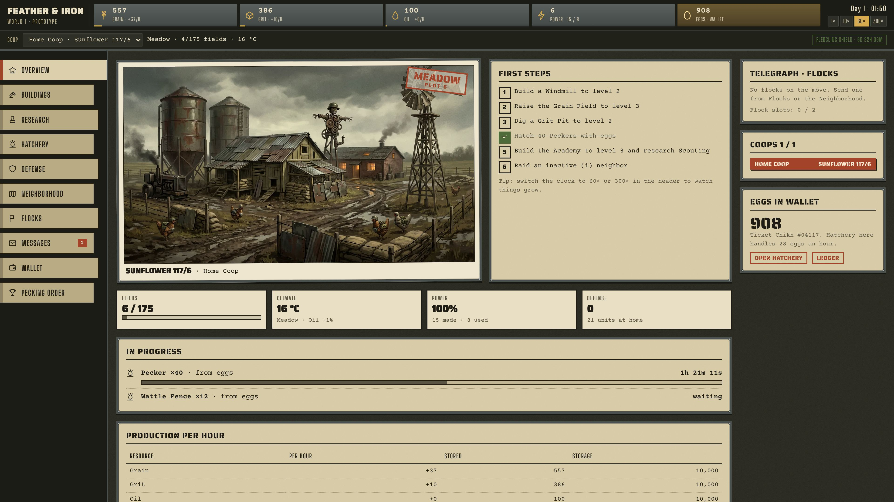
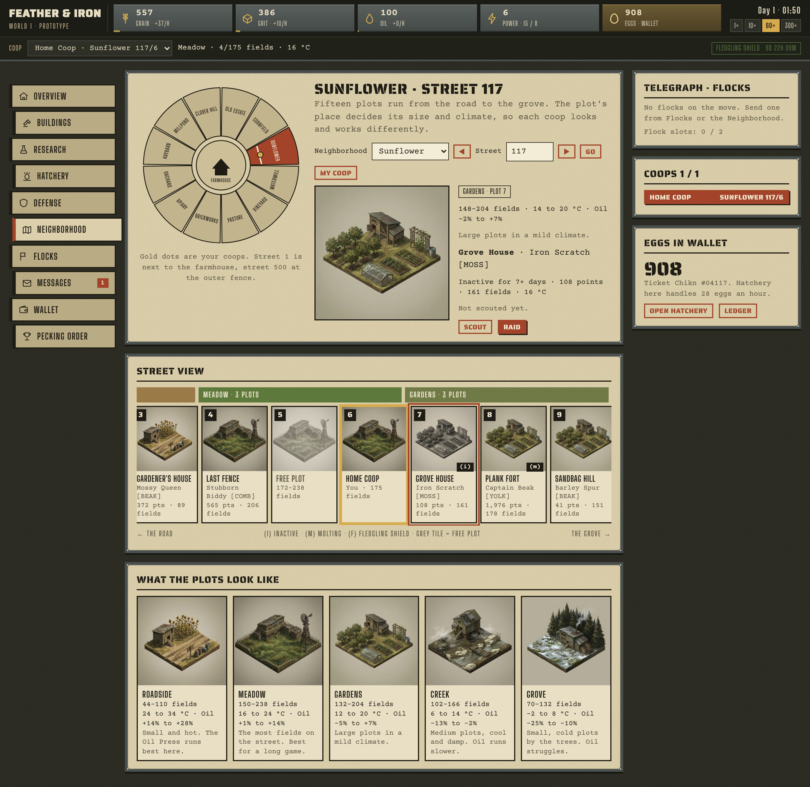
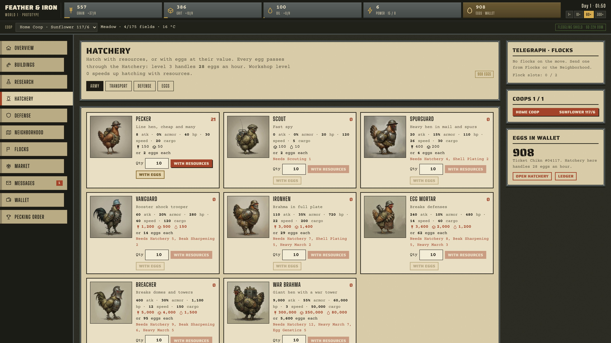
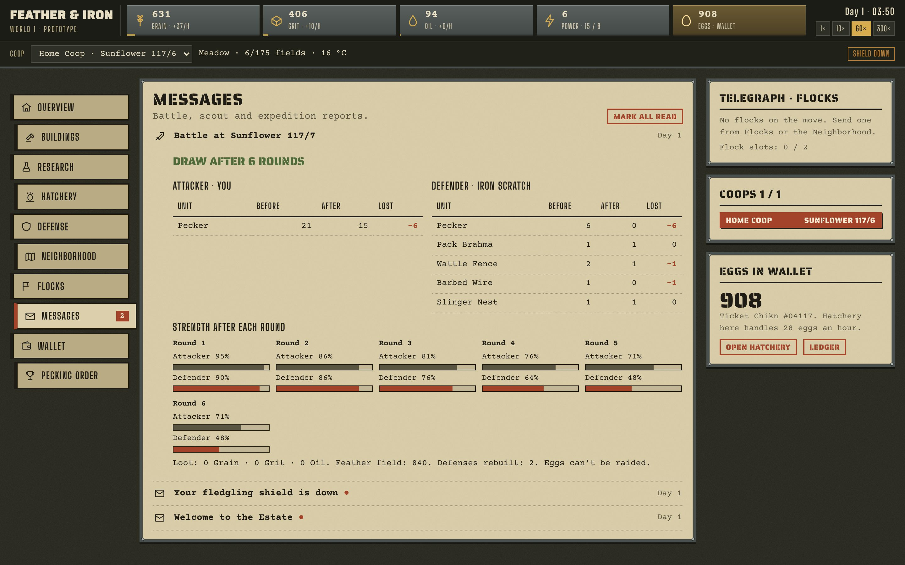
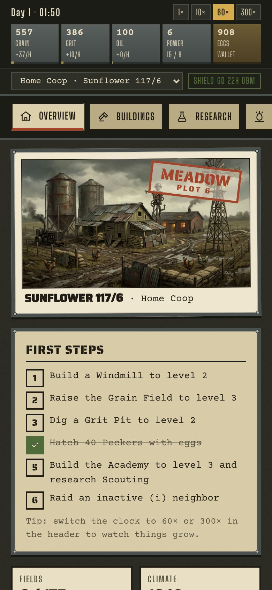

# Feather & Iron

A real-time browser strategy game for the 32,000 Chikn NFTs. Every Chikn is a ticket into the world: it opens one account with one home coop and brings a wallet of eggs. An egg can hatch into whatever the flock needs (a soldier, a pack hen, a wall) or crack into resources.

Coops stand in for planets and neighborhoods for galaxies. Where a coop stands on its street decides how much room it has to build and how well it presses Oil. You build, research, hatch chicken units in armor and war gear, send flocks, scout and raid the neighbors.



## Play the prototype

Run it from a local server:

```bash
python3 -m http.server 8000 --directory prototype
```

Then open http://localhost:8000.

On GitHub Pages: in the repository settings open **Pages**, deploy from branch `main`, folder `/ (root)`. The game is then at `/prototype/` and the design document at `/design/` under the Pages address.

Progress saves in the browser. When the page runs as a claude.ai Artifact it also saves to the Artifact database, private to each player.

### How a game starts

1. **Enter World 1.** Your home coop stands on Sunflower 117/6, a Meadow plot with 175 build fields, and the wallet holds 1,000 eggs.
2. **Buildings.** Windmills make Power; Grain Fields, Grit Pits and Oil Presses need it. One construction at a time per coop.
3. **Hatchery.** Hatch with resources (the Workshop speeds this up) or with eggs. Every egg passes through the Hatchery: level 3 handles 28 eggs an hour. Eggs can also crack into resources, and any queue can be finished early at 1 egg per 10 minutes.
4. **Neighborhood.** Twelve neighborhoods form a ring around the farmhouse, each with 500 streets of 15 plots. Pick a plot to scout, raid, settle or send a transport.
5. **Flocks.** Pick a mission, target, units and speed. The slowest unit sets the pace and the round trip's Oil is paid when the flock leaves. Reports arrive in Messages.
6. **Protection.** A fledgling shield lasts 7 game days and drops the moment you raid someone. After that, hostile flocks show up on the telegraph; a Watchtower spots them earlier.

The clock runs at 1×, 10×, 60× or 300×. At 60× one real minute is one game hour.

## Screens

| Neighborhood and street view | Hatchery |
|---|---|
|  |  |
| **Battle report** | **Phone** |
|  |  |

## Story

For generations the Farmer opened the gate at dawn, poured the grain and collected the eggs. Every coop on the Estate had an address, and every Chikn had its place in the Pecking Order.

One spring the gate stayed shut. In the farmhouse kitchen the Chikn found the Farmer's notebook on hatching. It taught them that an egg can hatch whatever the flock needs: a soldier, a pack hen, a wall.

The old coops by the farmhouse claimed the notebook and the full silo. The coops along the fence refused. The night the shared feeder was kicked over, the war for the Pecking Order began.

They fight over **Grain** (every building and soldier eats it), **Eggs** (the only thing that can become anything), **Meadow plots** (the most room to build, three per street) and **the Pecking Order** (rank used to be settled by the Farmer; now it is taken).

## Economy

| Resource | Use | Made by |
|---|---|---|
| Grain | Bulk material for everything | Grain Field |
| Grit | Research, armor, heavy units | Grit Pit |
| Oil | Fuel for every trip. Hot plots press more: +1.5% per °C above 15 °C | Oil Press |
| Power | Runs the three producers; short Power slows them down | Windmill, Compost Furnace (burns Oil) |
| Eggs | From the Chikn NFT. 1 egg = 200 Grain = 100 Grit = 50 Oil = 10 minutes of speed-up. Eggs can't be raided | 1,000 per NFT at the start |
| Feathers | Left on the field after a battle: 35% of the Grain and Grit in fallen units | Gleaners collect them |

## Plots and zones

Fifteen plots run along every street from the road to the grove. The plot number sets the zone.

| Plots | Zone | Build fields | Climate | Oil |
|---|---|---|---|---|
| 1–3 | Roadside | 44–110 | 24 to 34 °C | +14% to +28% |
| 4–6 | Meadow | 150–238 | 16 to 24 °C | +1% to +14% |
| 7–9 | Gardens | 132–204 | 12 to 20 °C | −5% to +7% |
| 10–12 | Creek | 102–166 | 6 to 14 °C | −13% to −2% |
| 13–15 | Grove | 70–132 | −2 to 8 °C | −25% to −10% |

Distance: 5 + plot gap on the same street, 20 + street gap in the same neighborhood, 400 + 80 per neighborhood step around the ring, 300 to the Wilds (expeditions).

## Units

Every unit is a chicken. Eggs per unit = (Grain + 2 × Grit + 4 × Oil) / 200, rounded up.

| Unit | Role | Cost (Grain / Grit / Oil) | Eggs | Attack | Armor | Health | Speed | Cargo |
|---|---|---|---:|---:|---:|---:|---:|---:|
| Pecker | Line hen, cheap and many | 150 / 50 / 0 | 2 | 8 | 0% | 40 | 30 | 20 |
| Pack Hen | Small transport | 150 / 120 / 0 | 2 | 1 | 0% | 60 | 24 | 400 |
| Scout | Fast spy | 0 / 100 / 10 | 2 | 0 | 0% | 20 | 120 | 5 |
| Spurguard | Heavy hen in mail and spurs | 400 / 200 / 0 | 4 | 20 | 15% | 110 | 26 | 30 |
| Pack Brahma | Large transport | 450 / 400 / 0 | 7 | 1 | 5% | 180 | 20 | 2,000 |
| Gleaner | Gathers feather fields | 800 / 500 / 200 | 13 | 1 | 0% | 300 | 9 | 1,600 |
| Settler Hen | Claims a free plot | 800 / 1,500 / 800 | 35 | 2 | 0% | 400 | 10 | 500 |
| Vanguard | Rooster shock trooper | 1,200 / 500 / 150 | 14 | 60 | 20% | 280 | 40 | 120 |
| Ironhen | Brahma in full plate | 3,000 / 1,400 / 0 | 29 | 110 | 35% | 720 | 22 | 200 |
| Egg Mortar | Breaks defenses | 3,600 / 2,000 / 1,200 | 62 | 240 | 10% | 480 | 14 | 40 |
| Breacher | Breaks domes and towers | 5,000 / 4,000 / 1,500 | 95 | 400 | 30% | 1,100 | 12 | 150 |
| War Brahma | Giant hen with a war tower | 300,000 / 250,000 / 80,000 | 5,600 | 9,000 | 55% | 60,000 | 3 | 50,000 |

## Defenses

| Defense | Note | Cost (Grain / Grit / Oil) | Eggs | Attack | Armor | Health |
|---|---|---|---:|---:|---:|---:|
| Wattle Fence | Cheap wall that soaks hits | 100 / 0 / 0 | 1 | 2 | 20% | 100 |
| Barbed Wire | Hurts light units | 160 / 40 / 0 | 2 | 6 | 0% | 90 |
| Slinger Nest | The basic shooter | 250 / 80 / 0 | 3 | 14 | 10% | 120 |
| Corn Cannon | Strong against heavy hens | 900 / 400 / 100 | 11 | 70 | 20% | 450 |
| Scarecrow Tower | The heavy tower | 4,000 / 2,500 / 600 | 57 | 300 | 30% | 2,200 |
| Small Shell Dome | Soaks 4,000 damage a round | 2,000 / 2,000 / 0 | 30 | 0 | 0% | 12,000 |
| Large Shell Dome | Soaks 20,000 damage a round | 10,000 / 10,000 / 0 | 150 | 0 | 0% | 60,000 |

## Buildings

Each building level takes one build field. Costs grow with every level.

| Building | What it does | Needs |
|---|---|---|
| Grain Field | Grows Grain, the bulk material for everything. | — |
| Grit Pit | Digs Grit for research, armor and heavy units. | — |
| Oil Press | Presses sunflower Oil, the fuel for every trip. Hot plots press more. | — |
| Windmill | Makes the Power that runs the three producers. | — |
| Compost Furnace | Burns Oil to make extra Power. | Henhouse 5, Oil Press 5 |
| Granary | Raises how much Grain the coop can hold. | — |
| Grit Bin | Raises how much Grit the coop can hold. | — |
| Oil Tank | Raises how much Oil the coop can hold. | — |
| Henhouse | The main building. Each level speeds up construction. | — |
| Workshop | Speeds up hatching with resources. | Henhouse 2 |
| Hatchery | Hatches units and defenses. Its level sets how many eggs it handles per hour. | Henhouse 2 |
| Academy | Runs research. Each level speeds it up. | Henhouse 1 |
| Fence Extension | Adds 4 build fields per level. | Henhouse 8, Academy 6 |
| Watchtower | Spots hostile flocks earlier: 30 minutes plus 30 per level. | Henhouse 4 |
| Feeder Depot | Feeds allied flocks guarding your coop. Alliances are not in this prototype. | Henhouse 6 |

## Research

One study at a time for the whole account.

| Research | Effect | Needs |
|---|---|---|
| Long Stride | +10% speed for light units per level | Academy 1 |
| Logistics | +1 flock in the field per level | Academy 1 |
| Shell Plating | +5% health per level | Academy 2 |
| Pack Training | +10% speed and +5% cargo for pack units per level | Academy 2 |
| Scouting | Reports show defenses from level 2, flocks from 4, buildings from 6 | Academy 3 |
| Cartography | One more coop every 2 levels | Academy 3 |
| Agronomy | +2% production per level | Academy 3 |
| Beak Sharpening | +5% attack per level | Academy 4 |
| Egg Genetics | +3% units per egg per level | Academy 4, Hatchery 4 |
| Down Padding | +2% armor per level, up to +20% | Academy 6 |
| Heavy March | +10% speed for heavy units per level | Academy 7 |

## Missions and combat

- **Missions:** Raid, Scout, Transport, Station, Settle, Glean and Expedition. Joint Raid and Guard need alliances, which the prototype doesn't have.
- **Combat:** up to 6 rounds. Each side's damage is spread over the other side's units by count and reduced by armor. Shell Domes soak damage meant for the other defenders. Some units hit certain targets several times harder: Egg Mortars against nests, cannons and wire, Breachers against domes and towers.
- **After the battle:** the winner carries off up to 40% of each stored resource, limited by cargo. 60% of lost defenses are rebuilt. Eggs are never raided.

## Repository

```
prototype/                 playable prototype; index.html is built from src/
  src/engine.js            game rules and simulation (no DOM)
  src/ui.js                screens, input and saving
  src/proto.css            the Trench look
  src/icons.js             interface icons
  img/                     40 game images (WebP)
  build.py                 builds index.html, or artifact.html with --artifact
design/                    design document v0.2: story, NFT ticket, eggs, resources, world, systems, art picks
archive/v1-serbian-design/ first concept in Serbian with SVG art, kept for reference
art/runway/                full-size Runway originals (PNG)
  trench/                  the chosen style, including every image used in the prototype
  heraldic/                the second style offered in the design document
  style-c-dropped/         an early third style, dropped (nothing futuristic)
media/                     corn-cannon-fires.mp4, a 10-second animation of the Corn Cannon
mint/                      the NFT collection: contract, mint page, Roostr snapshot and deploy tools (mint/README.md)
docs/screenshots/          images for this README
tests/                     engine-test.js, browser-test.js, docs-screenshots.js
```

## Development

Edit `prototype/src/`, then rebuild the page:

```bash
python3 prototype/build.py
```

Check the game rules (build, hatch, raid, scout, settle, transport, expeditions, hostile raids, save and load):

```bash
node tests/engine-test.js
```

Play the main flow in Chromium on a desktop and a phone screen (needs Playwright with Chromium):

```bash
node tests/browser-test.js
```

Regenerate the README screenshots:

```bash
node tests/docs-screenshots.js
```

## What the prototype leaves out

- The wallet is a demo (Chikn #04117 with 1,000 eggs). Nothing connects to a chain yet.
- There is no server. The neighbors are generated example players, so the game is single-player.
- Alliances (Joint Raid, Guard, Feeder Depot) are not in.
- The numbers are a first pass and need balancing.

## Art

All images were made with Runway (Gemini 3 Pro Image). The Corn Cannon animation was made with Seedance 2.5.
